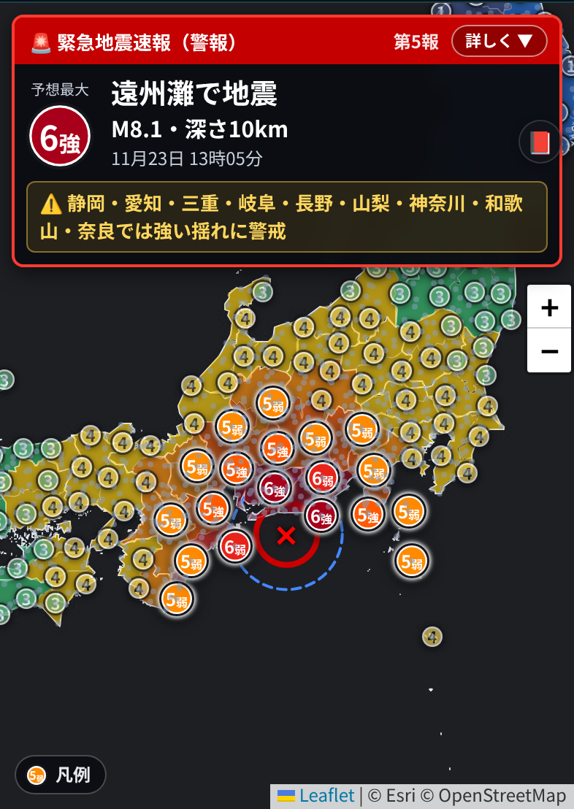
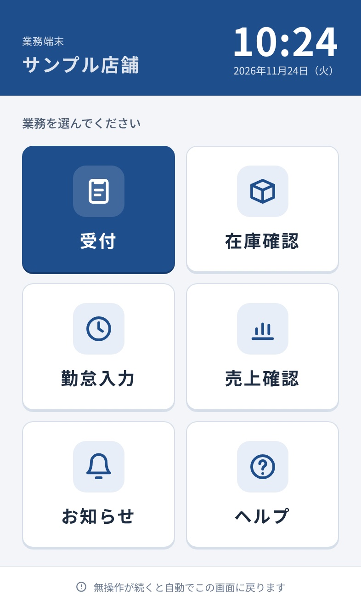
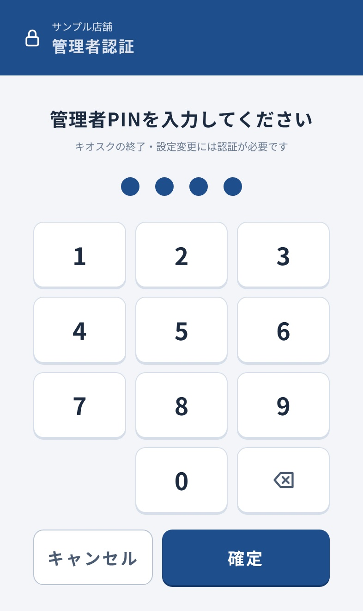
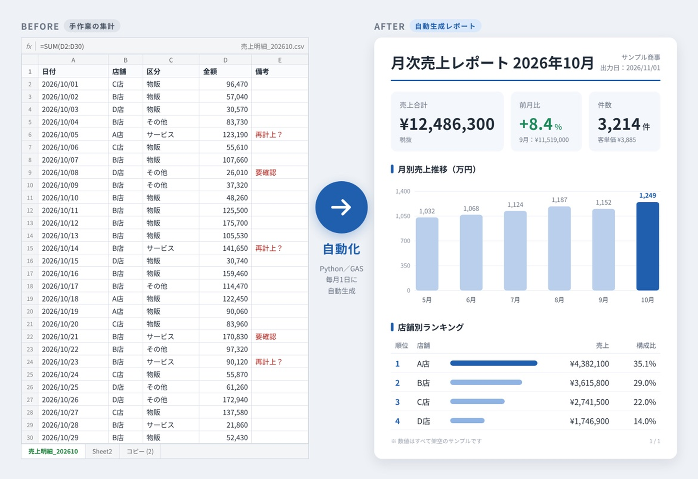

# 海斗（Kaito）

Python歴8年。24時間稼働の情報配信システムを一人で設計・開発・運用しています。
中学生の頃からシステム開発を続け、業務自動化・Bot開発・Webアプリ開発を中心に対応しています。

## 実績ギャラリー

### 防災情報配信システム（本番運用中）

- 防災・気象の情報を取得し、LINE・Discord等へ自動配信するシステムを一人で設計・開発・運用
- 配信は2016年に手作業で開始し、2018年に自動化、2022年に本格的なシステムとして構築。数万人規模へ24時間体制で配信中
- 配信担当者 数十名分の手作業を自動化
- 使用技術：Python（FastAPI／discord.py）、PostgreSQL、Linux
- 簡易再現サンプル：[disaster-alert-sample](https://github.com/kaito2oo5/disaster-alert-sample)（実コードは非公開のため、構成を再現したサンプルです）

### 業務用キオスクアプリ（納品済み）

 

※画面はイメージです（納品先の情報を含まない形で再現したもの）

- 業務用Android端末（POSレジ・業務用スマートフォン）向けのキオスク型アプリを開発し、企業へ納品（2023〜2024年）
- 表示できるページを制限し、業務以外の操作を防ぐ端末専用UI
- 使用技術：Python、Android
- 簡易再現サンプル：[kiosk-app-sample](https://github.com/kaito2oo5/kiosk-app-sample)

### LinkCare（個人開発中）

- アカウント同士で位置情報・端末状態・セキュリティ情報を共有する、iPhone／Androidアプリを個人開発中
- 使用技術：Flutter、FastAPI、PostgreSQL、WebRTC
- 簡易再現サンプル：[linkcare-sample](https://github.com/kaito2oo5/linkcare-sample)

### 業務自動化（Python／GAS）

- 月次レポートの自動生成、スプレッドシート集計の自動化など、繰り返し作業のツール化
- サンプル：[automation-samples](https://github.com/kaito2oo5/automation-samples)（Pythonの月次レポート自動生成＋GASの月次集計）

## スキル

- 言語：Python、TypeScript、JavaScript
- フレームワーク等：FastAPI、React、Node.js、discord.py、Flutter、Google Apps Script
- DB・基盤：PostgreSQL、Linux（Ubuntu）、GitHub Actions

## 対応について

- 副業として、深夜・土日を中心に対応しています
- 連絡はチャットのみでお願いしています
